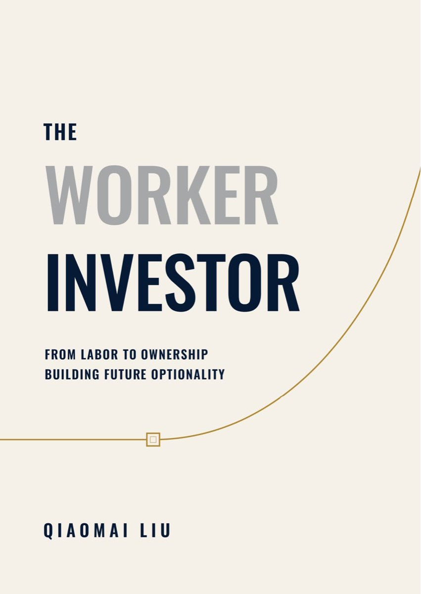

# The Worker Investor · 工资之外

  

**让今天的劳动，成为明天仍能使用的资产与选择权。**

[阅读中文版 PDF](./The-Worker-Investor.zh-CN.v2.7.pdf) · [下载中文版 PDF](./The-Worker-Investor.zh-CN.v2.7.pdf?raw=true)

中文阅读版 **v2.7** · PDF 更新于 **2026 年 10 月 12 日** · **422 页**

这是一本持续完善的书。本仓库提供完整 PDF，欢迎阅读、讨论与批评指正。

## Brief Contents · 简要目录

页码对应当前 v2.7 PDF 的印刷页码。

| 内容 | 页码 |
| --- | ---: |
| 前言 | xv |
| **Part I｜从 Worker 的现实处境出发** | **1** |
| 第 1 章　起点——我为什么开始思考 Worker Investor | 3 |
| 第 2 章　工资的安全感，也有它的边界 | 32 |
| 第 3 章　现代 worker 的困境：我们卖的不只是时间 | 47 |
| 第 4 章　从工厂钟声到日历、KPI 和 AI | 77 |
| **Part II｜Worker Investor Mindset** | **93** |
| 第 5 章　现金流与本金：把工资看成燃料，而不是身份 | 99 |
| 第 6 章　真假市场：黄金电子盘、赌场与概率素养 | 121 |
| 第 7 章　所有权与周期：股票如何诞生，又如何疯狂 | 149 |
| 第 8 章　金融底仓：ETF 与 Worker Investor 的长期胜率 | 177 |
| **Part III｜Human Capital ETF** | **206** |
| 第 9 章　Human Capital ETF：从“提升自己”到“配置自己” | 207 |
| 第 10 章　Core：先守住本金——健康、现金流与职业主线 | 231 |
| 第 11 章　Growth：为未来建立仓位——技能、AI 与第二曲线 | 248 |
| 第 12 章　Distribution：让价值离开身体——作品、渠道与可信度 | 267 |
| 第 13 章　Meta：成为自己的基金经理——判断、复盘与再平衡 | 285 |
| **Part IV｜Case Studies：Transformation Paths** | **304** |
| 第 14 章　Elon Musk——从 Worker 到 Working Founder | 306 |
| 第 15 章　Andrew Carnegie——把电报技能复利成工业系统 | 322 |
| 第 16 章　Benjamin Franklin——把手艺复利成公共基础设施 | 337 |
| 第 17 章　Naval Ravikant——从出租时间到拥有杠杆 | 353 |
| 第 18 章　Warren Buffett——把判断力复利成资本系统 | 373 |
| 结语：成为 Worker Investor | 389 |
| 附录： | 399 |

附录在当前阅读版中为预留页。

## 这本书讲什么

《The Worker Investor》写给依靠工作获得收入，也希望逐步建立更多选择的人。

工资支持当下的生活，也构成投资的本金。时间、技能和经验支持今天的工作，也可能转化为未来能够继续发挥作用的能力、作品、系统与所有权。本书把这些事情放在一起思考：几年工作之后，除了领到的工资，我们还能留下什么？

全书沿四部分展开：

1. **从 Worker 的现实处境出发**：理解工资的安全感与边界，以及工作对时间、注意力、情绪和生活的影响。
2. **Worker Investor Mindset**：重新认识现金流、本金、风险、所有权与市场周期，讨论 ETF 和长期金融投资的原则与局限。
3. **Human Capital ETF**：把投资者的视角用于自身，配置有限的时间、精力和金钱，让健康、职业、学习与作品之间形成积累。
4. **人物与转化路径**：通过马斯克、卡内基、富兰克林、纳瓦尔和巴菲特的经历，观察劳动、能力、组织和所有权如何相互连接，也讨论时代条件与个人路径的边界。

结语回到 **Future Optionality——未来选择权**：今天的积累，能否让我们在未来有更多条件，选择值得投入的工作与生活？

**Human Capital ETF** 是书内的人力资本配置框架，借用投资组合的视角，把“投资自己”拆成四个相互关联的仓位：

| 仓位 | 关注什么 |
| --- | --- |
| **Core · 核心** | 健康、现金流与职业主线，为持续行动守住基础 |
| **Growth · 成长** | 技能、AI、真实项目与第二曲线，为未来建立可能性 |
| **Distribution · 分发** | 作品、渠道与可信度，让经验和能力进入他人能够使用的载体 |
| **Meta · 判断与管理** | 判断、复盘与再平衡，检视整个组合的方向与投入 |

## 为什么写这本书

我的起点是金融投资中的亏损。它让我看见自己判断的局限，也促使我重新理解本金：对一个普通工作者来说，能够投入市场的资本，首先来自现实中的劳动与积累。

学习金融投资，让我开始重视原则、纪律与长期配置。但另一个问题仍然摆在面前：我该怎样投资那个产生本金的人，也就是我自己？在阅读相关书籍和回看自己的经历时，我一直希望把金融投资与工作、学习、创造之间的联系梳理得更清楚。

我仍然是一个 worker，也已经开始用 investor 的方式理解自己的资源。这本书记录的，就是这个过程：在继续工作的同时，怎样把一部分劳动转化为可以留存、复用和增长的东西，让未来的选择逐渐增加。

## 这本书希望带来什么

如果你也在两个发薪日之间生活，希望它能帮助你把几个问题想得更具体：

- 一份工作除了提供收入，还在积累哪些可迁移的能力与经验？
- 工资怎样支持生活，也为长期积累留下本金？
- 学习怎样进入真实问题，形成方法、作品与新的机会？
- 金融资产与人力资本怎样相互支持，有限资源应该怎样分配？
- 当环境或人生阶段变化时，怎样复盘并调整方向？

你可以从一个具体问题开始，检查自己的工作、学习计划、作品积累或资源配置。书中的框架也需要放回真实生活中检验，随着经验和反馈继续修正。

## 持续更新

我会持续更新这本书，重点包括：

- 完善内容、案例与论证，让表达更清楚。
- 改进数据图、概念图和制图，增加更多 artwork，让复杂关系更容易理解。
- 核查事实、数据与引用，补齐和纠正来源。

本仓库提供这份阅读介绍、书籍封面和一份当前中文 PDF。后续更新会替换阅读文件，并同步版本与日期；历次改动可在仓库历史中查看。

## 欢迎建议与批评

欢迎告诉我哪些地方有帮助，哪些地方说得不清楚，以及哪些观点、事实、图表或引用需要纠正。不同意见和具体批评同样欢迎。

- **邮件**：[69mike.com@gmail.com](mailto:69mike.com@gmail.com)
- **X**：[@humancapitaletf](https://x.com/humancapitaletf)

如果反馈涉及具体内容，请尽量注明 PDF 版本、页码和相关段落，便于我及时查找、核对与回应。

## 后续出版计划

我计划将本书翻译成英文，在 **Amazon Kindle** 上出版，之后也计划通过传统纸媒出版。相关进展会在这里继续更新，敬请期待。

感谢你的阅读，也感谢每一份帮助这本书变得更好的建议。

---

© 2026 刘乔迈（Qiaomai Liu）。保留所有权利。当前 PDF 免费提供个人阅读；欢迎分享本仓库链接。转载、翻译及商业出版请先联系作者。
