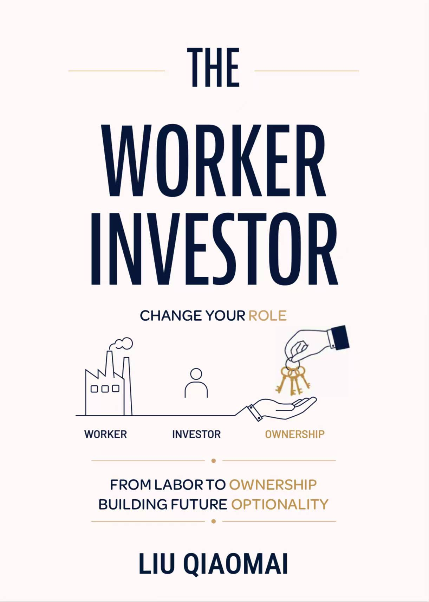

# The Worker Investor / 工资之外

  

  <strong>普通工作者如何把工资、技能、内容和资产，转化为未来选择权。</strong>

> Worker 负责获得现金流，Investor 负责把现金流转化为所有权、选择权和未来时间。

## Book Introduction

《The Worker Investor / 工资之外》是一本写给普通工作者的长期选择权手册。

它讨论一个人如何从 worker 开始，通过工资、储蓄、投资、技能、健康、内容资产、金融资产和系统建设，把现金流逐步转化为资产、所有权和未来自由。

这本书是《Human Capital ETF》的现实落地版：

> Human Capital ETF 是操作系统，The Worker Investor 是应用程序。

前者讲“如何配置自己”，后者讲“普通工作者如何把现实生活转化为资产和选择权”。

The writing position is deliberately unfinished:

> I am still inside the work system, but I no longer want to understand my future only as a worker.

## Chapters

| Chapter | Chapter title | File | Status |
| --- | --- | --- | --- |
| Preface | 不是逃离工作，而是不停留在卖时间这一层 | [`00-preface.md`](manuscript/00-preface.md) | Draft |
| Ch01 | 我为什么开始思考 Worker Investor | [`01-why-i-started-thinking-worker-investor.md`](manuscript/01-why-i-started-thinking-worker-investor.md) | Local draft; Notion rewrite pending |
| Ch02 | 工资的安全感，也有它的边界 | [`02-salary-security-boundary.md`](manuscript/02-salary-security-boundary.md) | Stub |
| Ch03 | 现代 worker 的困境：我们卖的不只是时间 | [`03-modern-worker-sells-more-than-time.md`](manuscript/03-modern-worker-sells-more-than-time.md) | Stub; Notion has material |
| Ch04 | 从工厂钟声到日历、KPI 和 AI | [`04-factory-bell-calendar-kpi-ai.md`](manuscript/04-factory-bell-calendar-kpi-ai.md) | Stub; Notion has material |
| Ch05 | 现金流与本金：把工资看成燃料，而不是身份 | [`05-salary-as-fuel-not-identity.md`](manuscript/05-salary-as-fuel-not-identity.md) | Stub |
| Ch06 | 真假市场：黄金电子盘、赌场与概率素养 | [`06-fake-markets-casino-probability.md`](manuscript/06-fake-markets-casino-probability.md) | Stub |
| Ch07 | 所有权与周期：股票如何诞生，又如何疯狂 | [`07-ownership-and-cycles.md`](manuscript/07-ownership-and-cycles.md) | Stub |
| Ch08 | 金融底仓：ETF 与 Worker Investor 的长期胜率 | [`08-etf-financial-core.md`](manuscript/08-etf-financial-core.md) | Stub; Notion has thick research |
| Ch09 | 投资不只是钱：Worker 的资产栈 | [`09-worker-asset-stack.md`](manuscript/09-worker-asset-stack.md) | Stub |
| Ch10 | Core：worker 的本金首先是健康和职业主线 | [`10-core-health-and-career.md`](manuscript/10-core-health-and-career.md) | Stub |
| Ch11 | Growth：技能、AI 与未来现金流 | [`11-growth-ai-and-future-cashflow.md`](manuscript/11-growth-ai-and-future-cashflow.md) | Stub |
| Ch12 | Distribution：内容资产、表达和可见性 | [`12-distribution-content-assets.md`](manuscript/12-distribution-content-assets.md) | Stub |
| Ch13 | Meta：复盘、思考和再平衡 | [`13-meta-review-and-rebalancing.md`](manuscript/13-meta-review-and-rebalancing.md) | Stub |
| Ch14 | 案例研究：沃伦·巴菲特 | [`14-buffett-case-study.md`](manuscript/14-buffett-case-study.md) | Stub |
| Conclusion | 成为 Worker Investor | [`99-conclusion-becoming-worker-investor.md`](manuscript/99-conclusion-becoming-worker-investor.md) | Stub |

For the full current structure, see [outline.md](outline.md). For writing and migration status, see [progress.md](progress.md).

## What This Project Is Not

- Not investment advice.
- Not a get-rich-quick guide.
- Not a quit-your-job manifesto.
- Not a startup hustle playbook.
- Not a book written from the position of “I have already succeeded, so let me teach you.”

## Core Thesis

The book keeps returning to a small set of core claims:

- 工资不是终点，工资只是普通人最早获得的现金流入口。
- Worker 的核心动作是 exchange，Investor 的核心动作是 ownership。
- 一个 worker 最大的风险，不是工资低，而是所有收入都只能依赖继续卖时间。
- 真正的 Worker Investor，不是不上班的人，而是不再把全部未来押在一份工作上的人。
- 我们无法延长自己的生命，但可以改变未来时间被谁支配。

## Project Status

- Current version: `v0.2 local structure sync`
- Writing source of truth: Notion
- GitHub role: public archive, manuscript versioning, and website source
- Language: Chinese, with selected English concepts such as Worker, Investor, Ownership, Distribution, Core, Growth, and Meta

This repository is an open book project in progress. Some chapters are readable drafts, some are structured stubs, and some still need to be migrated from Notion.

## Repository Guide

| Path | Purpose |
| --- | --- |
| `assets/` | Public repository assets, including the book cover |
| `manuscript/` | Book manuscript drafts and chapter stubs |
| `manuscript/archive/` | Older local drafts preserved for traceability |
| `materials/raw/` | Raw source materials |
| `materials/processed/` | Processed notes, models, and research digests |
| `scripts/` | Distribution drafts: posts, videos, and episode plans |
| `site/` | Website source/output for the project |
| `site-official/` | Current official static site version |
| `personal-bookshelf/` | Companion personal bookshelf web app |
| `book-bible.md` | Positioning, audience, core language, and writing boundaries |
| `style-guide.md` | Voice, privacy, terminology, and anti-generic-writing rules |
| `outline.md` | Current book structure |
| `progress.md` | Writing progress and migration status |

## Current Writing Priority

1. Migrate the complete Ch01 Notion rewrite into `manuscript/`.
2. Compress Ch08 ETF research into a readable chapter draft.
3. Shape Ch03 and Ch04 into the backbone of Part I.
4. Confirm Ch06-Ch14 statuses from Notion.
5. Decide what belongs in the public GitHub version versus private Notion notes.

## Privacy And Publishing Notes

- Company names, project names, salaries, private identities, and internal details should be anonymized before publication.
- Public GitHub files should not expose private Notion URLs, workspace IDs, or temporary asset URLs.
- Investment-related content is educational and reflective, not individualized financial advice.

## License

Copyright (c) 2026 Liu Qiaomai / Mike.

All rights reserved unless a more explicit license is added later. This book project is public for reading, versioning, and discussion, but the manuscript text is not automatically licensed for redistribution, commercial use, or derivative publication.
